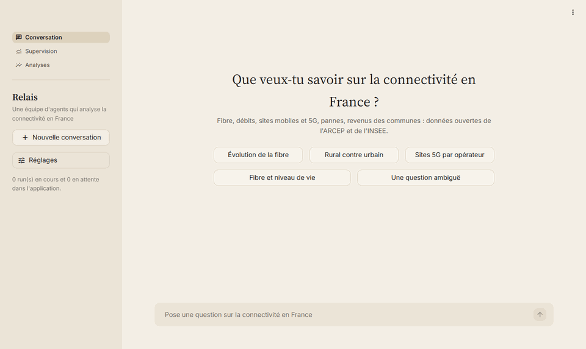
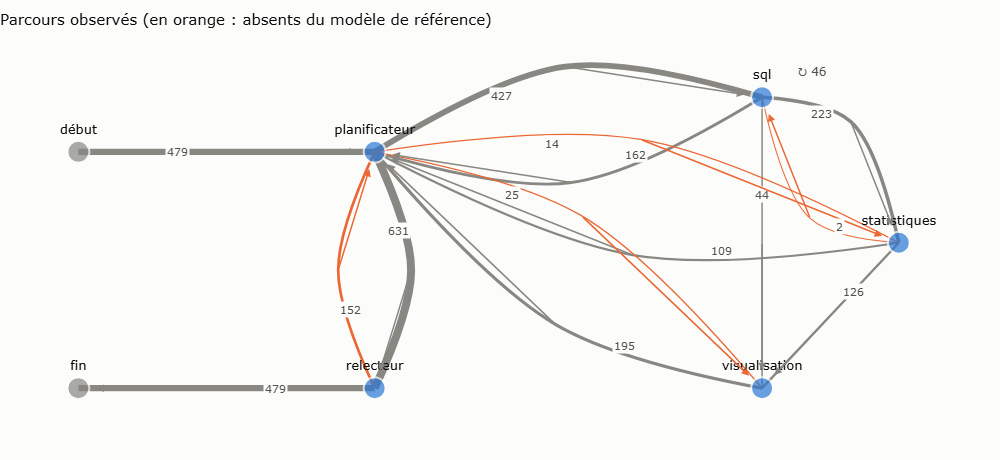
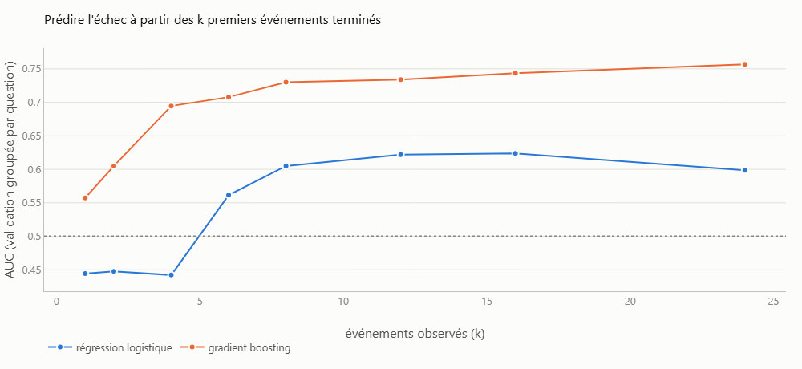

# Relais

*[Version française](README.md)*

Observability and process mining of a team of LLM agents that analyses connectivity in France (fixed and mobile).



*A question asked to the team (in French): the live run (span waterfall, team graph, failure risk), the answer with
its chart and sources, the full observability of the run with its alerts (here the reviewer sends a first draft
back), then the SQL query and its result.*

A LangGraph multi-agent team (planner, interpreter, SQL agent, statistics agent, visualisation agent, reviewer)
answers questions
on open data from ARCEP (the French telecom regulator) and INSEE (the national statistics institute). Every action
of the agents is traced with OpenTelemetry (GenAI semantic conventions), converted into XES and OCEL 2.0 event logs
and studied with process mining: how behaviour varies from one run to the next, which parameters drive it,
predicting failure while a run is still going, and a dashboard that watches the team live.

```
question -> LangGraph team -> OpenTelemetry spans -> XES / OCEL 2.0 -> process mining (pm4py)
                 |                    |                                    |
        checked answer        live dashboard                     variability experiment,
        (numbers, chart)      (graph, alerts, risk)              failure prediction
```

## Results at a glance

| Question | Result |
|---|---|
| Does the team answer correctly? | 36/50 on the development set (33/50 after human review); **20/24 on a test set never used while building the team**, identical over 3 runs |
| What does it cost? | $0.005 to $0.015 per question with gemini-3.1-flash-lite, 7.7 s median latency |
| Does behaviour vary between runs? | 42 distinct paths over 479 runs; **temperature** clearly increases path variability (p = 0.001) with no measurable effect on correctness |
| What drives correctness, cost, latency? | the **model** drives conformance, cost and latency; the planner **prompt** drives cost and latency; no factor has a significant effect on correctness with 20 questions |
| Do runs follow the designed process? | mean fitness 0.93; 6.2% of transitions fall outside the reference model, mostly rework requested by the reviewer |
| Can failure be predicted before the end? | AUC 0.70 after 4 events, 0.76 on the full trace (cross-validation grouped by question) |

Details in [`reports/`](reports/) (data checks, trace conversion, process mining, experiment, prediction; in
French), numbers in [`evaluation/results/`](evaluation/results/).

## Data

All data is open (Etalab Open Licence, checked on data.gouv.fr at download time and recorded with the URL and
sha256 of every file in the `sources` table): ARCEP fixed broadband eligibility by commune (23 quarters), mobile
sites, official mobile quality campaigns, mobile site outages, fibre network quality; INSEE density grid, official
geography and Filosofi 2023 incomes (with statistical confidentiality). There are no subscription prices, subscriber
counts or customer satisfaction in the data: questions about them have no answer, and comparisons between operators
stay factual.

```bash
pip install -r requirements.txt
python scripts/download_data.py      # ~730 MB in data/raw/ (ignored by git)
python scripts/build_database.py     # data/connectivite.duckdb (~70 MB), about 2 minutes
```

All cleaning happens once, in `build_database.py` (encodings, leading zeros, decimal commas, merged communes mapped
to the 2026 geography, speed classes made cumulative, daily outage files merged into incidents, sensitive columns
checked empty and never loaded). National totals recomputed from communes match ARCEP's national publication in all
23 quarters. See [`reports/controles_donnees.md`](reports/controles_donnees.md).

## Question set

[`benchmark/questions.yaml`](benchmark/questions.yaml): 50 development questions (SQL, SQL + statistics, SQL +
chart, full team, multi-step, and 12 traps: ambiguous, unanswerable, disguised causal questions, operator
comparisons that must stay factual), each with its expected status, its **expected path** through the team (the
reference model for conformance checking), a reference SQL and computation, and automatic checks (expected numbers
with tolerance, required and forbidden phrases, chart type). [`benchmark/questions_test.yaml`](benchmark/questions_test.yaml):
24 test questions on other aspects of the data, used only for measurement. Reference answers are computed from the
database, not typed by hand.

## Tools and team

- **SQL agent**: one read-only query at a time, with two independent locks: the query is parsed (sqlglot: one
  statement, a SELECT, only database tables, no function reading files or the environment), and DuckDB works on an
  in-memory copy with `enable_external_access=false` and `lock_configuration=true`.
- **Statistics agent**: Python in a separate process (isolated mode, empty folder, no API key in the environment)
  with an audit hook blocking files, network, subprocesses and ctypes, and a timeout. The hook guards against LLM
  mistakes; the security boundary is the **container**: with Docker, the code runs in a separate service on a
  network with no Internet access, with a read-only file system, an unprivileged user, no Linux capabilities and
  limits on memory, CPU and processes (see [Docker](#docker)).
- **Visualisation agent**: writes a chart specification that our code checks and draws with Plotly.
- **Planner**: no tool; splits the question into steps, asks for clarification or declines, then writes the answer.
- **Interpreter**: called only when code finds an ambiguous term in the question ("rural", "the incumbent
  operator", "recently"...): it maps each term to exact columns and values, the other agents follow it and the
  answer states it. Spelling variants ("Free" for "Free Mobile", case, accents) are fixed without an LLM by the
  SQL tool, which also reports any value that matches nothing, with the closest ones.
- **Reviewer**: checks with code that every number of the answer comes from a result, then asks the LLM about the
  reasoning (granularity, causality, neutrality); a rejected answer goes back to the planner, twice at most.

```bash
python -m relais.ask --trace "Quelle part des locaux est éligible à la fibre au 2e trimestre 2026 ?"
```

## OpenTelemetry tracing

Each run is a trace, each event a span: `invoke_agent equipe` (the run), `invoke_agent <agent>` (a turn),
`chat <model>` (an LLM call with `gen_ai.usage.*` tokens), `execute_tool <tool>` (SQL text, table produced, Python
code, chart specification, `error.message`). What the GenAI conventions do not cover goes into `relais.*`
attributes. Spans are exported as JSON lines.

## From traces to event logs

[`relais/eventlog.py`](relais/eventlog.py) builds **XES** (one case per run, at agent level or detailed level) and
**OCEL 2.0** (objects: question, run, agent, query, table, chart, code). [Conversion study](reports/conversion.md):
order, durations, resources and errors convert well; the span **hierarchy** is lost (a level must be chosen:
2,635 or 7,565 events), 3,123 tool calls nested in their agent's turn become successive events, and **shared
objects** (a table produced by a query, read by the statistics agent, drawn by the visualisation agent) are invisible
in XES while OCEL keeps them (25,130 event-object relations).

## Process mining



Reference model discovered (Inductive Miner) from the expected paths of the 50 questions. Mean alignment fitness
0.928, 323 of 479 runs perfectly fitting; 193 of 3,114 transitions (6.2%) fall outside the model, mostly reviewer to
planner (152 rework loops). Wrong answers have paths further from the expected one (edit distance 2.7 vs 1.0) and
twice as many reviewer loops. [Report](reports/process_mining.md).

## Variability experiment

Full factorial design: 2 models (gemini-3.1-flash-lite, gemini-3.5-flash-lite) × 2 temperatures (0, 1) × 2 planner
prompts ("standard" with rules and decision guide, "concise" without) × 20 questions × 3 repetitions = 479 runs
analysed, $4.68. [Report](reports/experience.md).

| Factor | Path variability | Fitness | Cost | Latency | Correctness |
|---|---|---|---|---|---|
| model | n.s. | p = 0.007 | p = 0.015 | p < 0.001 | n.s. (p = 0.13) |
| temperature | **p = 0.001** | n.s. | n.s. | n.s. | n.s. |
| prompt | n.s. | n.s. | p < 0.001 | p < 0.001 | n.s. (p = 0.34) |

At temperature 0, gemini-3.1-flash-lite almost always follows the same path for a question; at temperature 1 it
follows nearly 2 different paths over 3 repetitions. With the standard prompt it is more often right (80% vs 60% at
temperature 0), cheaper and faster than with the concise one. Disguised causal questions remain the most frequent
failure.

## Predicting failure during a run

From the first k finished events of a run and its configuration (not the question category, unknown for a real
question), a gradient boosting model predicts a wrong answer: AUC 0.56 after the first event, 0.70 after 4 events,
0.76 on the full trace, with cross-validation grouped by question (774 runs). [Report](reports/prediction.md).



## Dashboard

```bash
streamlit run app/dashboard.py
```

Conversation: ask a question as in a chat assistant; the answer comes with its chart, SQL queries and
sources (producer, dataset, licence, download date), derived by code from the tables actually read, never written
by the model. Dark mode and a light beige mode. Several people at once: a question goes into a shared queue and
runs in the background (at most 4 runs at once, 3 waiting questions per person); the Supervision page lists
everyone's runs, refreshed every second, and launches runs with the experiment settings. Run observability
(expandable under each answer): duration, cost, tokens and risk cards,
span waterfall, and watch the team graph (active agent, handovers, transitions outside the reference model
in orange), alerts (deviation, tool failure, reviewer rejection, slow step) and the failure-risk gauge updated at
every event. Replay mode: the same view on a recorded run, without an API key.

## Reproduce

```bash
python benchmark/build_references.py && python benchmark/build_references.py --lot test
python evaluation/run_benchmark.py                                  # 50 questions, about $0.4
python evaluation/run_benchmark.py --lot test --repetitions 3       # 72 runs, about $0.6
python evaluation/run_experiment.py                                 # 480 runs, about $5
python evaluation/analyze_experiment.py                             # conversion, process mining, experiment
python evaluation/train_failure_model.py                            # failure prediction
```

The Gemini key is read from `GEMINI_API_KEY` or `.streamlit/secrets.toml` (ignored by git).

## Docker

```bash
docker compose --profile donnees run --rm donnees     # once: download the data and build the database
docker compose up --build                             # then open http://localhost:8510
```

Two containers from the same image: `relais` (the Streamlit app and the agents, with Internet access for the
Gemini API) and `relais-sandbox`, which runs the Python code of the statistics agent on an internal network with
**no Internet access**, a read-only file system (except an in-memory `/tmp`), the `nobody` user, no Linux
capabilities, `no-new-privileges`, and limits of 1 GB of memory, 2 CPUs and 128 processes.

## Tests and limits

`python -m pytest`: no LLM and no network (scripted fake LLM per role); runs in GitHub Actions CI on every push.

Honest limits: the scoring checks that the right numbers are present, not that they are labelled correctly (hence
the human review); a few prompt rules were added after a 5-question pilot and the scoring was fixed after the first
full run (both documented in the French README); the experiment uses 20 questions and 3 repetitions per cell, so
weak effects are not detectable; the predicted risk is an alert signal, not a guaranteed probability.

## Licences

Data: Etalab Open Licence. pm4py is distributed under AGPL v3.
