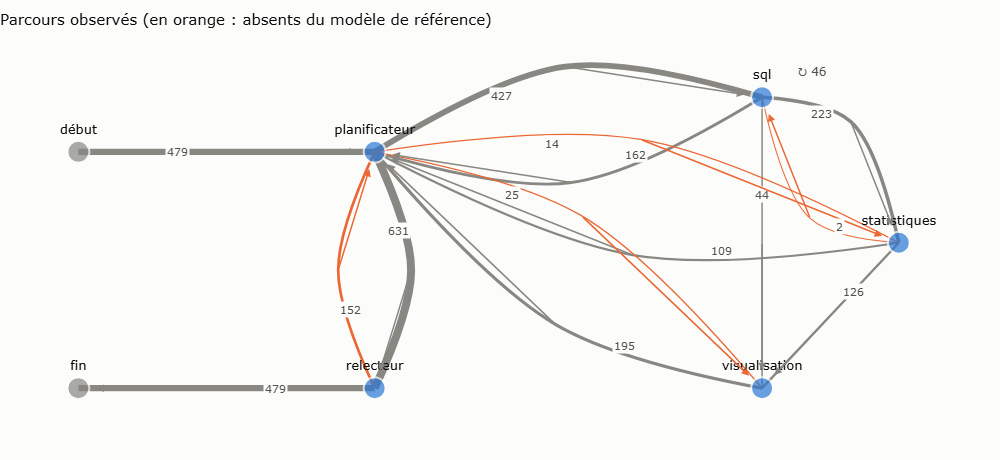
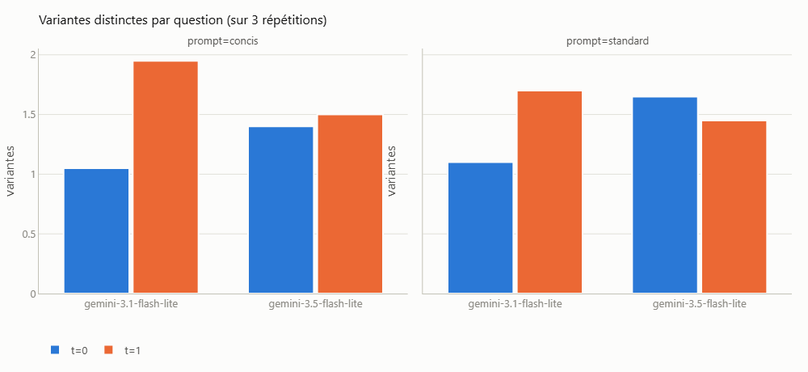
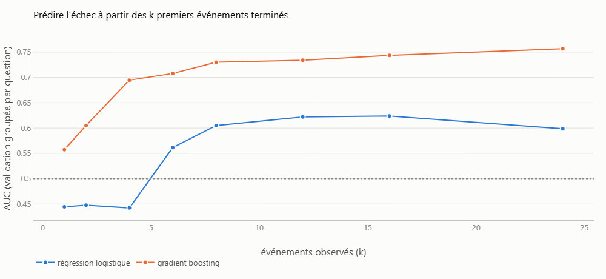

# Relais

*[English version](README.en.md)*

Observabilité et process mining d'une équipe d'agents LLM qui analyse la connectivité en France (fixe et mobile).

Une équipe multi-agent LangGraph (planificateur, agent SQL, agent statistiques, agent visualisation, relecteur)
répond à des questions sur les données ouvertes de l'ARCEP et de l'INSEE. Chaque action des agents est journalisée
avec OpenTelemetry (conventions GenAI), convertie en journaux d'événements XES et OCEL 2.0, puis étudiée par process
mining : variabilité d'une exécution à l'autre, facteurs qui l'influencent, prédiction de l'échec en cours de run,
et un tableau de bord qui observe l'équipe en temps réel.

```
question -> équipe LangGraph -> spans OpenTelemetry -> XES / OCEL 2.0 -> process mining (pm4py)
                 |                     |                                     |
          réponse vérifiée     tableau de bord en direct          expérience de variabilité,
          (chiffres, graphe)   (graphe, alertes, risque)          prédiction de l'échec
```

## Résultats en bref

| Question | Résultat |
|---|---|
| L'équipe répond-elle juste ? | 36/50 sur le lot de développement (33/50 après relecture humaine) ; **20/24 sur un lot de test jamais utilisé pendant la mise au point**, identique sur 3 passages |
| Combien ça coûte ? | 0,005 à 0,015 $ par question avec gemini-3.1-flash-lite, 7,7 s en médiane |
| Le comportement varie-t-il d'un run à l'autre ? | 42 parcours distincts sur 479 runs ; la **température** augmente nettement la variabilité des parcours (p = 0,001) sans effet mesurable sur la justesse |
| Qu'est-ce qui pèse sur la justesse, le coût, la latence ? | le **modèle** joue sur la conformité, le coût et la latence ; le **prompt** du planificateur sur le coût et la latence ; aucun facteur n'a d'effet significatif sur la justesse avec 20 questions |
| Les parcours suivent-ils le modèle prévu ? | fitness moyenne 0,93 ; 6,2 % des transitions sortent du modèle de référence, surtout les reprises demandées par le relecteur |
| Peut-on prévoir l'échec avant la fin ? | AUC 0,70 après 4 événements et 0,76 sur la trace complète (validation groupée par question) |

Détails : [`reports/`](reports/) (contrôles des données, conversion des traces, process mining, expérience,
prédiction), chiffres dans [`evaluation/results/`](evaluation/results/).

## Données

Toutes les données sont ouvertes, sous Licence Ouverte Etalab. La licence est relue sur data.gouv.fr au moment du
téléchargement (le script s'arrête si elle n'est pas ouverte) et notée, avec l'URL et l'empreinte sha256 de chaque
fichier, dans la table `sources` de la base.

| Source | Producteur | Licence | Utilisation |
|---|---|---|---|
| [Ma connexion internet](https://www.data.gouv.fr/datasets/ma-connexion-internet/) | ARCEP | Licence Ouverte v2.0 | Éligibilité des locaux par technologie et par débit, par commune, 23 trimestres (2019_T3 à 2026_T2) |
| [Mon réseau mobile](https://www.data.gouv.fr/datasets/mon-reseau-mobile) | ARCEP | Licence Ouverte v1.0 | Sites mobiles (un relevé par an depuis 2018 et le dernier trimestre), campagnes officielles de qualité de service (indicateurs 2019 à 2025, mesures individuelles 2025) |
| [Sites indisponibles](https://www.data.gouv.fr/datasets/sites-indisponibles) | ARCEP | Licence Ouverte v1.0 | Pannes et maintenances de sites mobiles, 12 derniers mois |
| [Qualité des réseaux en fibre optique](https://www.data.gouv.fr/datasets/qualite-des-reseaux-en-fibre-optique) | ARCEP | Licence Ouverte v2.0 | Taux de pannes et d'échecs de raccordement FttH |
| [Grille communale de densité 2026](https://www.insee.fr/fr/information/8571524) | INSEE | Licence Ouverte v2.0 ([conditions INSEE](https://www.insee.fr/fr/information/2008466)) | Communes, population municipale 2023, niveaux de densité |
| [Filosofi 2023](https://catalogue-donnees.insee.fr/fr/catalogue/recherche/DS_FILOSOFI_CC) | INSEE | Licence Ouverte v2.0 ([conditions INSEE](https://www.insee.fr/fr/information/2008466)) | Niveau de vie médian et taux de pauvreté par commune (avec le secret statistique), département, région |
| [Code officiel géographique 2026](https://www.data.gouv.fr/datasets/code-officiel-geographique-1) | INSEE | Licence Ouverte v1.0 | Départements, régions, fusions de communes |

Ces données ne contiennent ni prix d'abonnement, ni nombre d'abonnés, ni satisfaction client : les questions qui
en dépendent n'ont pas de réponse dans la base, et l'analyse reste factuelle entre opérateurs.

## Construire la base

```bash
pip install -r requirements.txt
python scripts/download_data.py      # ~730 Mo dans data/raw/ (ignoré par git)
python scripts/build_database.py     # data/connectivite.duckdb (~70 Mo), environ 2 minutes
```

Tout le nettoyage se fait une seule fois dans `build_database.py` ; les agents ne voient que des tables propres,
décrites colonne par colonne dans [`relais/schema.py`](relais/schema.py) (aussi copié dans la table
`dictionnaire`). La construction échoue si une colonne n'est pas documentée ou si une clé n'est pas unique.

Ce que le nettoyage a trouvé dans les fichiers publiés est détaillé dans
[`reports/controles_donnees.md`](reports/controles_donnees.md), notamment :

- les classes de débit sont exclusives en 2019_T3 puis cumulatives : toutes sont rendues cumulatives, et une vue
  `fixe_debits_classes` donne les classes exclusives ;
- les totaux nationaux recalculés depuis les communes sont égaux à la publication nationale de l'ARCEP dans les
  23 trimestres (le fichier national de 2020_T3 a lui-même une colonne incohérente) ;
- 943 codes de communes fusionnées depuis 2017 et les arrondissements de Paris, Lyon et Marseille sont ramenés à
  la géographie 2026 ;
- des numéros de sites mobiles ont été abîmés par un tableur (1,03E+05) : la table utilise une clé technique ;
- les pannes sont publiées en fichiers quotidiens des pannes en cours : elles sont fusionnées en incidents ;
- les colonnes imei et imsi des mesures sont vérifiées vides et ne sont jamais chargées ;
- Filosofi 2023 : le taux de pauvreté est couvert par le secret statistique dans 29 512 communes sur 34 768 ; chaque valeur porte son statut (diffusé, secret statistique, non disponible).

## Jeu de questions

[`benchmark/questions.yaml`](benchmark/questions.yaml) contient 50 questions, écrites avant les agents pour ne pas
être ajustées à leurs réponses : SQL seul (12), SQL + statistiques (8), SQL + visualisation (7), équipe complète
(6), plusieurs étapes (5) et 12 pièges (questions ambiguës, réponses absentes des données, questions causales
déguisées, comparaisons d'opérateurs qui doivent rester factuelles).

Chaque question porte :

- le statut attendu de la réponse (répondue, demande de clarification, ou impossible avec ces données) ;
- le **parcours attendu** dans l'équipe (par exemple planificateur, SQL, statistiques, planificateur qui rédige,
  relecteur), qui sert de modèle de référence pour le conformance checking ;
- un SQL de référence et, pour les questions statistiques, le calcul de référence (scipy) ;
- les vérifications automatiques de la réponse : chiffres attendus avec leur tolérance, mentions obligatoires
  (par exemple « corrélation » et « causalité » pour une question causale), formulations interdites (« meilleur
  opérateur »), type de graphique.

Un second lot, [`benchmark/questions_test.yaml`](benchmark/questions_test.yaml), contient 24 questions de **test**
(mêmes catégories, autres aspects des données : câble, sites 4G historiques, qualité de la fibre, débit montant,
qualité audio des appels, pauvreté départementale...). Il a été écrit après le premier benchmark et sert uniquement
à mesurer l'équipe sur des questions qui n'ont pas servi à la mettre au point.

```bash
python benchmark/build_references.py              # lot de développement -> benchmark/references.json
python benchmark/build_references.py --lot test   # lot de test -> benchmark/references_test.json
```

Les réponses de référence ne sont pas saisies à la main : elles sont calculées depuis la base et figées avec la
version des données utilisée.

## Outils des agents

Chaque agent n'a accès qu'à ses outils, et chaque outil est verrouillé par notre code, pas par le prompt :

- **Agent SQL** ([`relais/tools/sql.py`](relais/tools/sql.py)) : une seule requête de lecture à la fois. Deux
  verrous indépendants : la requête est analysée avant exécution (sqlglot : une seule instruction, un SELECT, seules
  les tables de la base, aucune fonction qui lit des fichiers ou l'environnement), et DuckDB lui-même travaille sur
  une copie en mémoire avec `enable_external_access=false` et `lock_configuration=true`. Chaque requête a un délai
  maximal ; son résultat complet est gardé pour les autres agents, le LLM n'en voit qu'un aperçu.
- **Agent statistiques** ([`relais/tools/sandbox.py`](relais/tools/sandbox.py)) : le code Python s'exécute dans un
  processus séparé (mode isolé, dossier vide, environnement réduit sans clé d'API) avec pandas, scipy et
  statsmodels ; un hook d'audit bloque fichiers, réseau, sous-processus et ctypes, et le processus est arrêté au
  bout du délai. Le résultat revient en JSON, jamais en pickle. Limite : ce hook protège des erreurs d'un LLM, ce
  n'est pas une frontière de sécurité contre un attaquant déterminé (il faudrait un bac à sable du système, comme
  un conteneur sans réseau).
- **Agent visualisation** ([`relais/tools/charts.py`](relais/tools/charts.py)) : il écrit une spécification
  (type, tableau, colonnes, titres) que notre code vérifie puis dessine avec Plotly : couleurs dans un ordre fixe
  (palette vérifiée pour les daltoniens), un seul axe vertical, étiquettes directes jusqu'à 4 séries.

Les tests essaient de contourner chaque verrou (COPY, ATTACH, read_csv, deux requêtes, lecture de la clé, ouverture
de fichiers, réseau, boucle infinie...).

## L'équipe

```
planificateur -> (sql | statistiques | visualisation)* -> planificateur -> relecteur -> fin
                                                              ^              |
                                                              +-- à corriger +
```

- Le **planificateur** n'a aucun outil : il découpe la question en étapes confiées aux agents, ou demande une
  clarification, ou explique que les données ne permettent pas de répondre ; une fois les étapes faites, il rédige
  la réponse à partir de leurs résultats.
- L'**agent SQL**, l'**agent statistiques** et l'**agent visualisation** n'ont chacun que leur outil (voir
  ci-dessus) et un nombre limité d'appels.
- Le **relecteur** vérifie d'abord par du code que chaque nombre de la réponse vient d'un résultat (ou de la
  documentation des données) et qu'un graphique demandé a bien été dessiné, puis demande au LLM de contrôler le
  raisonnement (granularité, causalité, neutralité entre opérateurs). Une réponse refusée repart au planificateur,
  deux fois au plus.
- Chaque tour d'agent, appel au LLM et appel d'outil est enregistré avec son début, sa fin et ses attributs
  ([`relais/team/trace.py`](relais/team/trace.py)) : c'est la matière de la journalisation des étapes suivantes.

Modèle : `gemini-3.1-flash-lite` (0,25 $ par million de tokens en entrée, 1,50 $ en sortie,
[tarifs Google](https://ai.google.dev/gemini-api/docs/pricing)).

```bash
python -m relais.ask --trace "Quelle part des locaux est éligible à la fibre au 2e trimestre 2026 ?"
python evaluation/run_benchmark.py            # les 50 questions, notées automatiquement
python evaluation/run_benchmark.py --lot test --repetitions 3
```

### Résultats du benchmark (gemini-3.1-flash-lite, température 0)

Notation sans juge LLM : une réponse est juste si son statut est le bon (répondue, clarification, impossible), si
chaque chiffre attendu y figure à la tolérance près, si les mentions obligatoires y sont et les formulations
interdites absentes, et si le graphique demandé a été dessiné.

| Catégorie | Justes | Parcours conformes | Coût moyen | Latence moyenne |
|---|---|---|---|---|
| SQL seul | 9/12 | 9/12 | 0,0059 $ | 5,2 s |
| SQL + statistiques | 5/8 | 3/8 | 0,0081 $ | 8,9 s |
| SQL + visualisation | 5/7 | 2/7 | 0,0095 $ | 9,3 s |
| Équipe complète | 4/6 | 2/6 | 0,0116 $ | 13,4 s |
| Plusieurs étapes | 4/5 | 1/5 | 0,0143 $ | 14,1 s |
| Pièges : ambiguës | 2/3 | 3/3 | 0,0011 $ | 1,4 s |
| Pièges : impossibles | 4/4 | 4/4 | 0,0011 $ | 1,3 s |
| Pièges : causales | 1/3 | 1/3 | 0,0012 $ | 1,6 s |
| Pièges : opérateurs | 2/2 | 1/2 | 0,0091 $ | 8,0 s |
| **Total** | **36/50 (72 %)** | **26/50** | **0,37 $ en tout** | **7,7 s (médiane)** |

**Lot de test** (24 questions jamais utilisées pendant la mise au point, 3 passages) : **20/24 à chacun des trois
passages (83 %)**, 0,60 $ pour les 72 runs, latence médiane 7,8 s
([`evaluation/results/test_flash-lite-3.1_t0.csv`](evaluation/results/test_flash-lite-3.1_t0.csv)).

**Relecture humaine** des 36 réponses notées justes : 33 sont entièrement justes. Trois ont les bons chiffres
mais une interprétation trompeuse que la notation automatique ne voit pas : V05 compte les pannes par mois depuis
2022 alors que les relevés ne couvrent que 12 mois, P11 désigne Orange par son code 20801 au lieu de son nom, M04
attribue le nombre de sites 4G au mauvais trimestre. **Score après relecture : 33/50 (66 %).**

Ce que montrent les erreurs :

- **Granularité** : recalculer sur les mesures brutes un indicateur que l'ARCEP publie déjà pondéré (Q09), ou
  filtrer les mauvais tests (S08), donne des taux très différents de la référence ; le relecteur LLM ne l'a pas vu.
- **Prudence excessive** : le planificateur répond « impossible » à des questions qui demandent une réponse factuelle
  assortie de limites (taux de pauvreté sous secret statistique S07, question causale P08, pannes par opérateur P10)
  ou une clarification (P02).
- **Parcours** : seule la moitié des parcours suit exactement le modèle attendu ; les écarts les plus fréquents sont
  un passage par l'agent statistiques pour un simple calcul et les reprises demandées par le relecteur. C'est la
  variabilité qu'étudient les étapes suivantes.

Limites honnêtes :

- **Corrections après un pilote.** Après un pilote de 5 questions (Q01, S01, V02, M01, P10), trois règles générales
  ont été ajoutées aux prompts (l'agent SQL ne calcule pas de statistiques et exprime les taux en %, « impossible »
  seulement si aucune donnée ne permet d'aborder la question) et l'outil graphique accepte les deux orientations
  d'une barre ; les 45 autres questions n'avaient pas été vues. Une de ces règles a eu un effet de bord sur M01
  (l'agent statistiques a pris un classement déjà calculé pour des données manquantes).
- **Corrections du jeu de questions.** Après le premier passage (34/50, fichier
  `evaluation/results/premier_passage_flash-lite-3.1.csv`), quatre défauts de l'évaluation ont été corrigés :
  E01, E04 et E06 précisent désormais la corrélation de Spearman attendue, E01 et E06 n'exigent plus un nombre de
  départements que la question ne demande pas, S04 accepte une demi-largeur d'intervalle, P12 vérifie seulement le
  fait demandé (l'ARCEP publie deux décomptes légèrement différents des sites 5G d'Orange) ; un plantage du graphe
  (nouvelles étapes demandées au-delà de la limite) a été corrigé.
- **L'évaluation vérifie la présence des chiffres, pas leur sens** : une réponse qui cite le bon nombre avec une
  mauvaise unité ou une mauvaise période peut être comptée juste (d'où la relecture humaine ci-dessus). Les
  comptages doivent être exacts (un nombre de communes à l'unité près) ; cette règle a été ajoutée après la
  relecture, qui avait trouvé 29 526 communes acceptées au lieu de 29 512.
- **Un seul passage à température 0** sur le lot de développement : la variabilité d'un passage à
  l'autre est mesurée par l'expérience ci-dessous.

## Journalisation OpenTelemetry

[`relais/telemetry.py`](relais/telemetry.py) : chaque run est une trace, chaque événement un span, avec les
conventions sémantiques GenAI.

| Span | Nom | Attributs principaux |
|---|---|---|
| le run | `invoke_agent equipe` | `gen_ai.conversation.id`, `gen_ai.request.model`, `gen_ai.request.temperature`, question, statut de la réponse, tokens |
| un tour d'agent | `invoke_agent <agent>` | `gen_ai.agent.name`, `relais.action` (planifier, rediger, etape, relire), consigne, verdict du relecteur |
| un appel au modèle | `chat <modèle>` | `gen_ai.provider.name`, `gen_ai.request.model`, `gen_ai.usage.input_tokens`, `gen_ai.usage.output_tokens` |
| un appel d'outil | `execute_tool <outil>` | `gen_ai.tool.name`, texte SQL, tableau produit et nombre de lignes, code Python, spécification du graphique, `error.message` |

Les conventions couvrent les agents, les modèles, les tokens et les outils ; le reste (texte SQL, verdict du
relecteur) va dans des attributs `relais.*`. Les spans sont exportés en JSON lines, une ligne par span.

## Des traces aux journaux d'événements

[`relais/eventlog.py`](relais/eventlog.py) convertit les spans en **XES** (un cas par run, au niveau des agents ou
au niveau détaillé) et en **OCEL 2.0** (objets : question, run, agent, requête, tableau, graphique, code). Les
journaux de l'expérience sont dans [`reports/eventlogs/`](reports/eventlogs/).

[Étude de la conversion](reports/conversion.md) : l'ordre, les durées, les ressources et les erreurs passent bien ;
la **hiérarchie** des spans est perdue (il faut choisir un niveau : 2 635 ou 7 565 événements), 3 123 appels d'outil
imbriqués dans le tour de leur agent deviennent des événements successifs, et les **objets partagés** (un tableau
produit par une requête, lu par l'agent statistiques, dessiné par l'agent visualisation) sont invisibles en XES
alors que l'OCEL les garde (25 130 relations). Aplatir l'OCEL sur un autre objet que le run fusionne les
répétitions (question) ou duplique des événements (tableau).

## Process mining

[`relais/mining.py`](relais/mining.py), [rapport](reports/process_mining.md). Le modèle de référence est découvert
(Inductive Miner) à partir des parcours attendus des 50 questions.



- **Conformité** : fitness des alignements 0,928 en moyenne ; 323 runs sur 479 parfaitement conformes.
- **Écarts** : 193 transitions sur 3 114 (6,2 %) sortent du modèle, surtout relecteur vers planificateur (152
  reprises) et des passages directs du planificateur à la visualisation ou aux statistiques.
- **Passation** : le planificateur est le centre du réseau (631 passages vers le relecteur, 427 vers l'agent SQL).
- **Parcours et justesse** : les réponses fausses ont des parcours plus éloignés du parcours attendu (distance
  d'édition 2,7 contre 1,0) et deux fois plus de reprises du relecteur.

## Expérience de variabilité

[`evaluation/run_experiment.py`](evaluation/run_experiment.py), [rapport](reports/experience.md). Plan factoriel :
2 modèles (gemini-3.1-flash-lite, gemini-3.5-flash-lite) × 2 températures (0, 1) × 2 prompts du planificateur
(« standard » avec règles et guide de décision, « concis » sans) × 20 questions × 3 répétitions = 479 runs
analysés, 4,68 $.

| Facteur | Variabilité des parcours | Fitness | Coût | Latence | Justesse |
|---|---|---|---|---|---|
| modèle | n.s. | p = 0,007 | p = 0,015 | p < 0,001 | n.s. (p = 0,13) |
| température | **p = 0,001** | n.s. | n.s. | n.s. | n.s. |
| prompt | n.s. | n.s. | p < 0,001 | p < 0,001 | n.s. (p = 0,34) |



- À température 0, gemini-3.1-flash-lite suit presque toujours le même parcours pour une question (1,05 à 1,10
  variante sur 3 répétitions) ; à température 1, il en suit près de 2.
- Avec le prompt « standard », gemini-3.1-flash-lite est plus juste (80 % contre 60 % à température 0), moins cher
  et plus rapide (7,8 s contre 10,5 s en médiane) qu'avec le prompt « concis » ; gemini-3.5-flash-lite est peu
  sensible au prompt.
- Les questions causales déguisées restent l'échec le plus fréquent (12,5 % de justesse) : le planificateur répond
  « impossible » au lieu de donner la corrélation avec ses limites.

## Prédiction de l'échec en cours de run

[`relais/prediction.py`](relais/prediction.py), [rapport](reports/prediction.md). À partir des k premiers
événements terminés d'un run (tours d'agents, appels d'outils et leurs échecs, refus du relecteur, tokens, durée)
et de la configuration, sans la catégorie de la question (inconnue pour une vraie question), un gradient boosting
prédit si la réponse sera fausse.



AUC 0,56 au premier événement (presque seulement la configuration), 0,70 après 4 événements, 0,76 sur la trace
complète, en validation croisée groupée par question (774 runs). Le modèle est à peu près calibré (risque prédit
0,10 pour 14 % d'échecs observés, 0,89 pour 70 %) ; c'est un signal d'alerte, pas une garantie.

## Tableau de bord

```bash
streamlit run app/dashboard.py
```

- **En direct** : on pose une question ; le graphe de l'équipe s'anime (agent actif, passations, transitions hors
  du modèle de référence en orange), les alertes s'affichent (déviation, échec d'outil, refus du relecteur, étape
  lente) et la jauge de risque d'échec évolue à chaque événement ; puis la réponse, le graphique, les requêtes.
- **Rejouer un run** : la même vue sur un run enregistré, sans clé d'API.
- Les rapports de l'expérience, du process mining, de la prédiction et de la conversion.

La logique de surveillance ([`relais/monitor.py`](relais/monitor.py)) est indépendante de Streamlit et testée.

## Reproduire

```bash
pip install -r requirements.txt
python scripts/download_data.py && python scripts/build_database.py      # données et base
python benchmark/build_references.py && python benchmark/build_references.py --lot test
python evaluation/run_benchmark.py                                      # 50 questions, environ 0,4 $
python evaluation/run_benchmark.py --lot test --repetitions 3           # 72 runs, environ 0,6 $
python evaluation/run_experiment.py                                     # 480 runs, environ 5 $
python evaluation/analyze_experiment.py                                 # conversion, process mining, expérience
python evaluation/train_failure_model.py                                # prédiction de l'échec
streamlit run app/dashboard.py
```

La clé Gemini se lit dans la variable `GEMINI_API_KEY` ou dans `.streamlit/secrets.toml` (ignoré par git).

## Tests

```bash
python -m pytest
```

Les tests n'utilisent ni LLM ni réseau (faux LLM scripté par rôle) : outils verrouillés et tentatives de
contournement, équipe et ses boucles, évaluation, spans OpenTelemetry, conversion XES et OCEL, process mining,
moniteur, prédiction, démarrage du tableau de bord. Ils tournent dans la CI GitHub Actions à chaque push.

## Licences

Données : Licence Ouverte Etalab (voir ci-dessus). pm4py est distribué sous licence AGPL v3.
