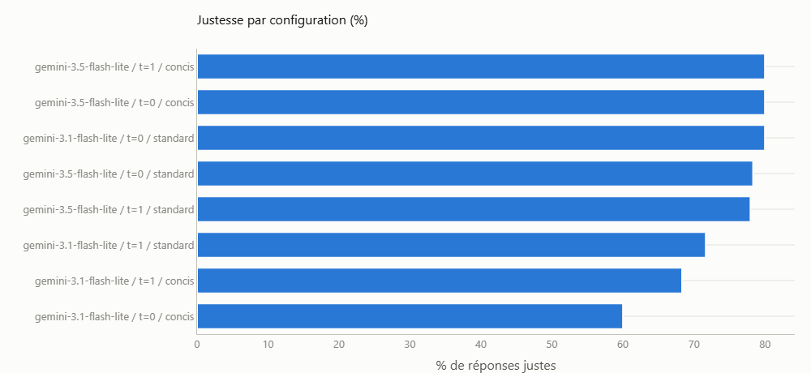
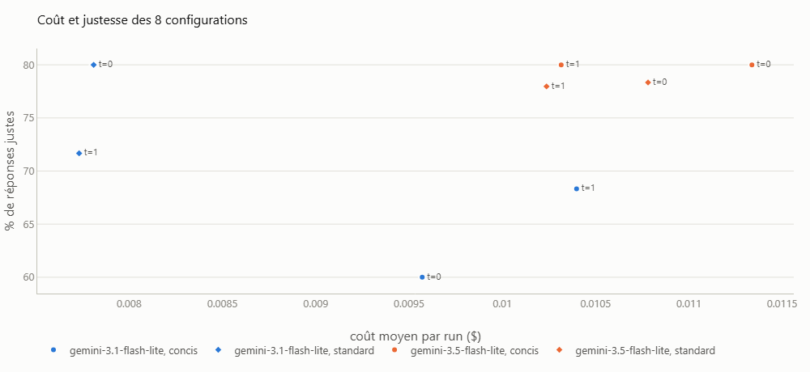
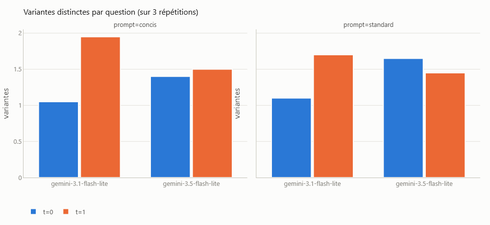

# Expérience de variabilité

Généré par `evaluation/analyze_experiment.py`. Plan factoriel complet : 2 modèles Gemini (gemini-3.1-flash-lite et gemini-3.5-flash-lite) × 2 températures (0 et 1)
× 2 prompts du planificateur (« standard » avec règles et guide de décision, « concis » sans) × 20 questions du lot
de développement (toutes les catégories) × 3 répétitions = 479 runs, 4,68 $ au total.

Mesures : pour chaque cellule (configuration × question), le nombre de variantes de parcours distinctes sur les
3 répétitions, leur entropie (0 si les 3 parcours sont identiques), la distance d'édition moyenne entre
répétitions ; pour chaque run, la justesse, la fitness au modèle de référence, le coût et la latence.

## Les 8 configurations

| modele | température | prompt | runs | justesse | fitness | latence_mediane | variantes_par_question | entropie | distance_entre_repetitions | coût pour 1 000 runs ($) |
| --- | --- | --- | --- | --- | --- | --- | --- | --- | --- | --- |
| gemini-3.1-flash-lite | 0,00 | concis | 60 | 60,00 | 0,91 | 10,47 | 1,05 | 0,05 | 0,07 | 9,57 |
| gemini-3.1-flash-lite | 0,00 | standard | 60 | 80,00 | 0,94 | 7,83 | 1,10 | 0,08 | 0,13 | 7,81 |
| gemini-3.1-flash-lite | 1,00 | concis | 60 | 68,33 | 0,90 | 12,28 | 1,95 | 0,82 | 1,33 | 10,40 |
| gemini-3.1-flash-lite | 1,00 | standard | 60 | 71,67 | 0,92 | 7,78 | 1,70 | 0,59 | 1,12 | 7,73 |
| gemini-3.5-flash-lite | 0,00 | concis | 60 | 80,00 | 0,95 | 5,98 | 1,40 | 0,34 | 0,57 | 11,34 |
| gemini-3.5-flash-lite | 0,00 | standard | 60 | 78,33 | 0,93 | 5,62 | 1,65 | 0,56 | 0,87 | 10,78 |
| gemini-3.5-flash-lite | 1,00 | concis | 60 | 80,00 | 0,95 | 6,58 | 1,50 | 0,42 | 0,60 | 10,32 |
| gemini-3.5-flash-lite | 1,00 | standard | 59 | 77,97 | 0,92 | 6,14 | 1,45 | 0,38 | 0,65 | 10,24 |

## Quels facteurs comptent ? (p-valeurs)

Modèles linéaires avec la question en effet fixe (ANOVA de type II) pour l'entropie, la distance, la fitness, le
coût et la latence ; régression logistique GEE (corrélation intra-question échangeable) pour la justesse.

| facteur | entropie des parcours | distance entre répétitions | fitness | coût (log) | latence (log) | justesse (GEE) |
| --- | --- | --- | --- | --- | --- | --- |
| modele | 0,629 | 0,956 | 0,007 | 0,015 | 0,000 | 0,126 |
| temperature | 0,001 | 0,001 | 0,228 | 0,987 | 0,306 | 0,884 |
| prompt | 0,950 | 0,740 | 0,706 | 0,000 | 0,000 | 0,341 |

Rapports de cotes de la justesse (référence : gemini-3.1-flash-lite, température 0, prompt concis) :

| terme | rapport_de_cotes | p-valeur |
| --- | --- | --- |
| modele = gemini-3.5-flash-lite | 1,605 | 0,126 |
| temperature = 1.0 | 0,983 | 0,884 |
| prompt = standard | 1,285 | 0,341 |

## Par type de question

| categorie | runs | justesse | entropie | variantes |
| --- | --- | --- | --- | --- |
| Équipe complète | 48 | 97,92 | 0,51 | 1,62 |
| Plusieurs étapes | 48 | 75,00 | 0,53 | 1,62 |
| Piège : question ambiguë | 24 | 75,00 | 0,11 | 1,12 |
| Piège : question causale déguisée | 48 | 12,50 | 0,37 | 1,44 |
| Piège : réponse absente des données | 24 | 100,00 | 0,00 | 1,00 |
| SQL seul | 120 | 88,33 | 0,29 | 1,32 |
| SQL + statistiques | 95 | 60,00 | 0,61 | 1,72 |
| SQL + visualisation | 72 | 87,50 | 0,44 | 1,50 |

## Limites

- 20 questions et 3 répétitions par cellule : les effets faibles ne sont pas détectables ; l'entropie sur 3
  répétitions ne prend que quelques valeurs.
- Les modèles ont des latences très différentes : la latence mesure aussi la charge de l'API au moment du run.
- Les questions sont celles du lot de développement (celles qui ont servi à concevoir l'équipe).
