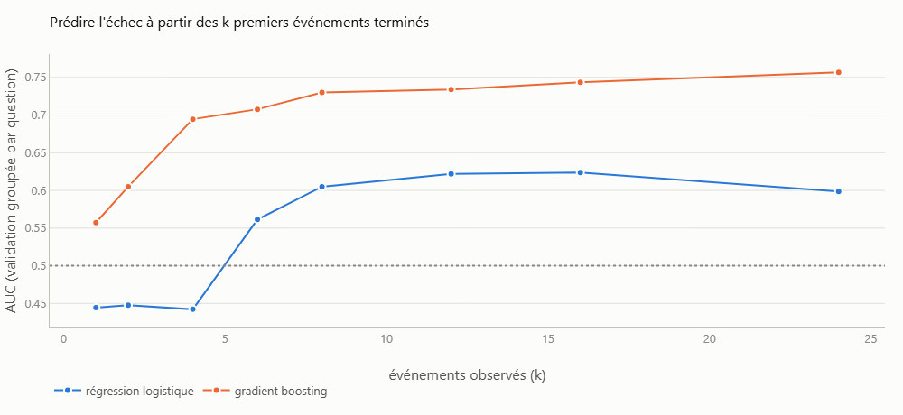

# Prédire l'échec en cours de run

Généré par `evaluation/train_failure_model.py`. Données : 774 runs tracés (expérience de
variabilité et benchmarks), dont 25,5 % de réponses fausses. Pour chaque run, on ne
regarde que ses k premiers événements terminés (tours d'agents, appels au modèle, appels d'outils), comme un
observateur en direct.

Caractéristiques : configuration (modèle, température, prompt) et ce qui s'est déjà passé (tours de chaque agent,
appels et échecs d'outils, refus du relecteur, tokens, durée). La catégorie de la question n'est pas utilisée : elle
est inconnue pour une vraie question. Validation croisée en 5 groupes **par question** : le modèle est toujours
évalué sur des questions qu'il n'a pas vues.

## AUC par longueur de préfixe

| longueur | gradient boosting | régression logistique |
| --- | --- | --- |
| 1 | 0,557 | 0,444 |
| 2 | 0,605 | 0,448 |
| 4 | 0,695 | 0,442 |
| 6 | 0,708 | 0,561 |
| 8 | 0,730 | 0,605 |
| 12 | 0,734 | 0,622 |
| 16 | 0,744 | 0,624 |
| 24 | 0,757 | 0,599 |
| complet | 0,754 | 0,590 |

## Calibration (gradient boosting, tous préfixes)

| tranche | predictions | risque_predit | echecs_observes |
| --- | --- | --- | --- |
| (-0.001, 0.2] | 3 103 | 0,10 | 0,14 |
| (0.2, 0.4] | 2 458 | 0,29 | 0,26 |
| (0.4, 0.6] | 640 | 0,49 | 0,38 |
| (0.6, 0.8] | 363 | 0,70 | 0,51 |
| (0.8, 1.0] | 402 | 0,89 | 0,70 |

## Lecture et limites

- Le modèle retenu pour le tableau de bord est « gradient boosting », réentraîné sur toutes les données
  (`models/risque_echec.joblib`).
- Au tout début (k = 1, le seul plan du planificateur) le risque ne dépend presque que de la configuration ; il
  s'affine à mesure que les agents agissent, et les refus du relecteur sont un signal fort.
- Les runs d'une même question se ressemblent : sans validation groupée par question, l'AUC serait surestimée.
- Les données viennent d'un seul jeu de questions ; le risque prédit est un signal d'alerte, pas une probabilité
  garantie sur d'autres questions.
