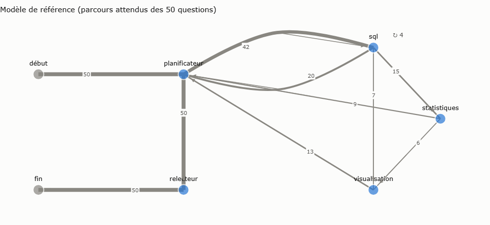
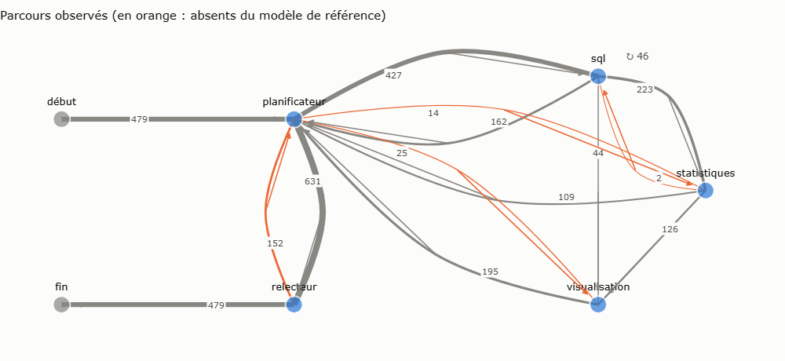

# Process mining des parcours de l'équipe

Généré par `evaluation/analyze_experiment.py` sur 479 runs (journal XES au niveau des agents).

## Modèle de référence et découverte

Le modèle de référence est découvert (Inductive Miner) à partir des parcours attendus des 50 questions : c'est le
comportement pour lequel l'équipe est conçue.

- **Conformité au modèle de référence** (fitness des alignements) : 0,928 en
  moyenne ; 323 runs sur 479 sont
  parfaitement conformes.
- **Modèle découvert sur les runs** (Inductive Miner, sans filtre de bruit) : fitness
  1,000 sur ses propres traces, un modèle plus permissif qui
  autorise les reprises.
- **Écarts au modèle de référence** : 193 transitions sur 3 114
  (6,2 %) n'existent pas dans le modèle de référence :
  relecteur → planificateur (152), planificateur → visualisation (25), planificateur → statistiques (14), statistiques → sql (2).

## Variantes

42 variantes pour 479 runs ; les 10 plus fréquentes :

| variante | cas | part |
| --- | --- | --- |
| planificateur > sql > planificateur > relecteur | 94 | 23,6 |
| planificateur > relecteur | 76 | 19,1 |
| planificateur > sql > statistiques > visualisation > planificateur > relecteur | 53 | 13,3 |
| planificateur > sql > statistiques > planificateur > relecteur | 44 | 11,1 |
| planificateur > sql > statistiques > visualisation > planificateur > relecteur > planificateur > relecteur | 40 | 10,1 |
| planificateur > sql > visualisation > planificateur > relecteur | 34 | 8,5 |
| planificateur > sql > statistiques > planificateur > relecteur > planificateur > relecteur | 21 | 5,3 |
| planificateur > sql > planificateur > relecteur > planificateur > relecteur | 18 | 4,5 |
| planificateur > sql > visualisation > planificateur > relecteur > planificateur > relecteur | 9 | 2,3 |
| planificateur > sql > planificateur > relecteur > planificateur > visualisation > planificateur > relecteur | 9 | 2,3 |

## Réseau de passation entre agents

| de | vers | passations |
| --- | --- | --- |
| planificateur | relecteur | 631 |
| planificateur | sql | 427 |
| sql | statistiques | 223 |
| visualisation | planificateur | 195 |
| sql | planificateur | 162 |
| relecteur | planificateur | 152 |
| statistiques | visualisation | 126 |
| statistiques | planificateur | 109 |
| sql | visualisation | 44 |
| planificateur | visualisation | 25 |
| planificateur | statistiques | 14 |
| statistiques | sql | 2 |

## Parcours et justesse

| juste | runs | fitness | distance | longueur | reprises |
| --- | --- | --- | --- | --- | --- |
| réponse fausse | 122 | 0,89 | 2,73 | 5,70 | 0,52 |
| réponse juste | 357 | 0,94 | 1,03 | 5,43 | 0,25 |

Les réponses fausses suivent des parcours plus longs, plus éloignés du parcours attendu et avec plus de reprises
demandées par le relecteur : la forme du parcours renseigne sur le risque d'échec (exploité par la prédiction en
cours de run).
